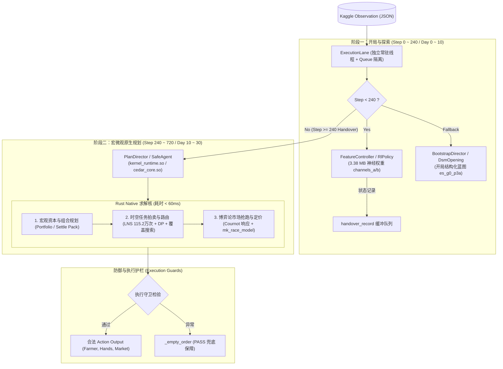

## 终局战报：距离全球金牌仅一步之遥

在刚刚落幕的 Kaggle **Kaggriculture** 智能体决策模拟挑战赛中，我们团队（**霉运霉运快走开！！！**）经过漫长的天梯常规赛与赛后 48 小时的最终对决，最终在全场 **10,148 支参赛队伍** 中定格在 **全球第 35 名**（Top 0.34%），斩获了一枚含金量十足的 **Silver Medal（银牌）**。

这是继 [ROGII 地质时序首银](/posts/kaggle-rogii-first-silver)、[AI Agent Security 攻防二银](/posts/kaggle-ai-agent-security-silver-expert) 以及 [PTCG 宝可梦卡牌三银](/posts/kaggle-pokemon-tcg-ai-silver) 之后，我们在 Kaggle 斩获的**第四块银牌**。


> [!NOTE]
> **战况微澜：距离金牌线（Rank 30）仅差 5 个身位**
>
> 最终榜单定格时，金牌线划在第 30 名（5,099.6 分），而我们以 **5,081.4 分** 位列 **第 35 名**。在破万支队伍的大赛场上，与全球金牌仅差 18.2 分、5 个名次！虽然略带遗憾，但在充满强随机性与对手动态博弈的模拟大乱斗中，我们的两个 Agent 经受住了近千场实战与最后锦标赛洗礼，展现了极强的策略韧性。


---

## 比赛在考什么？多维时空经济系统与博弈论农场

与以往纯粹的分类/回归任务不同，**Kaggriculture** 是一个典型的**双人零和/非完全信息动态经济博弈沙盒**：
- **时钟与资源约束**：每局比赛持续 30 个游戏日（共 720 个微观决策回合，每天 24 步）。双方初始拥有 3,000 金币启动资金，并在一个 10×10 的网格土地上起步（开局仅激活西北象限的 5×5 区域）。
- **多要素交织闭环**：
  - **地块与作物**：从麦子（Wheat）、胡萝卜（Carrot）到高单价经济作物番茄（Tomato），作物具有不同的生长期、水分需求、防虫防草维护成本。
  - **畜牧与副业**：奶牛（Cow）与绵羊（Sheep）需要稳定的青草喂养，产出高溢价的生乳与羊毛，但一旦看护缺失会触发昂贵的动物逃逸惩罚。
  - **物流与工人**：最多可招募 16 名农场工人，工人具有物理移动速度、负重上限、换装与往返损耗。
  - **动态现货市场**：双方共享同一个本地供需市场。任何单方的集中抛售都会根据边际供需曲线瞬间压低收购价，甚至引发价格踩踏；同格抢单时更存在残酷的“物理抢跑”机制。

```text
┌────────────────────────────────────────────────────────┐
│             Kaggriculture 宏观经济运行链路              │
└──────────────────────────┬─────────────────────────────┘
                           │
         ┌─────────────────┼─────────────────┐
         ▼                 ▼                 ▼
   【土地与基建】      【劳动力与物流】     【市场与现金流】
   - 4 象限土地开辟    - 最多 16 名工人    - 动态价格供需曲线
   - 作物生长期管理    - 负重/调度冲突     - 抢跑与防踩踏抛售
   - 畜牧看护与防逃    - 每日日落回仓清空  - 破晓流动性再投资
```

在 720 步的微观执行中，Agent 不仅要规划自己的最优投入产出比，还要实时侦测对手的战术意图、防止货仓爆仓，并在单步仅有 **1.5 秒硬时限** 的苛刻环境下给出无死锁决策。

---

## 赛制深探：从两周常规赛到 48 小时 Bradley-Terry 锦标赛

很多未深入接触 Kaggle Simulation 赛道的选手常有疑问：为什么最终榜单的分数（如 5,081.4 分）与平时的天梯积分（2,700+ 分）完全不同？赛后那漫长的两天究竟发生了什么？

### 1. 两周封榜常规赛：天梯双雄的平稳并跑
在封榜前的最后两周闭门对局中，系统随机匹配线上不同分段的 Agent 进行常规对战。我们锁定的两个最终提交——**Meridian Reserve (`mer`)** 与 **Canopy (`can`)** 在这一阶段完成了近千场真实对局：
- `mer`（Meridian）：961 局，520 胜 441 负，胜率 54.1%，天梯分稳定在 **2,723.5**；
- `can`（Canopy）：994 局，534 胜 460 负，胜率 53.7%，天梯分稳定在 **2,727.9**。

两条积分曲线全程紧贴金牌线（2,768.3 分）上方边缘巡航，表现出极高的稳定性。


### 2. 揭秘后赛期：为什么需要 Bradley-Terry 锦标赛？
常规赛结束后，官方并未直接采纳最后一刻的 Elo 积分，而是进行了为期 48 小时的 **Bradley-Terry (BT) 矩阵锦标赛**。

在策略博弈游戏中，直接使用传统 Elo 存在著名的“剪刀石头布（Intransitivity）”陷阱与匹配方差：某些 Agent 可能专门克制某种特定流派（如无脑低价倾销流），但在大盘上并不健壮；或者因为最后几局恰好匹配到低分弱智 Agent 而产生分数虚高。

为了构建绝对公允的全局战力天梯，Kaggle 引入了经典的 **Bradley-Terry 成对比较概率模型**：
假设全场任意两个智能体 $i$ 和 $j$，其底层潜藏着一个真实的、不随对手变化的全局战力参数 $\pi_i, \pi_j > 0$。智能体 $i$ 击败智能体 $j$ 的概率满足 Logistic 胜率函数：

$$
P(i \succ j) = \frac{\pi_i}{\pi_i + \pi_j} = \frac{1}{1 + e^{-(\beta_i - \beta_j)}}
$$

其中 $\beta_i = \ln \pi_i$ 为对数胜率优势标量。

在 48 小时的锦标赛期间，官方调度集群驱动数万个 Agent 进行全排列矩阵式密集推演，构建出全局对战胜负转移矩阵。随后通过**最大似然估计（MLE）** 与对数似然对偶优化，迭代求解全场 10,148 支队伍的隐式实力向量：

$$
\mathcal{L}(\boldsymbol{\beta}) = \sum_{i < j} \left[ W_{ij} \ln \frac{e^{\beta_i}}{e^{\beta_i} + e^{\beta_j}} + W_{ji} \ln \frac{e^{\beta_j}}{e^{\beta_i} + e^{\beta_j}} \right]
$$

这一机制彻底过滤掉了局部运气与匹配随机性。只有无论面对极端防守、疯狗倾销还是顶尖工业级求解器都能保持高胜率期望的 Agent，才能在 Bradley-Terry 矩阵投影中脱颖而出。我们的双版本正是在这 48 小时的大洗牌中稳稳守住了前 35 名的顶尖排位！

---

## 双提交系统：稳健对冲与极致冲榜的双塔哲学

在 Kaggle 这类非平稳博弈中，押注单一模型具有极大的不可逆风险。我们的最终双提交经过了极其严谨的角色划分与战略对冲：

```
                      ┌──────────────────────────────────────────────┐
                      │          Kaggriculture 最终锁定双提交          │
                      └──────────────────────┬───────────────────────┘
                                             │
             ┌───────────────────────────────┴───────────────────────────────┐
             ▼                                                               ▼
【Sub 1: Meridian Reserve】                                       【Sub 2: Canopy Primary】
• 战略定位：稳健对冲 / 保底安全仓 (Safe Hedge)                    • 战略定位：激进冲榜 / 天梯收割 (Apex Climber)
• 配置标识：EDITION='meridian', CONTROL_STYLE='safe'              • 配置标识：mode_primary (全植物学混淆)
• 运行时：kernel_runtime.so (71.7 MB Rust/C-API)                  • 运行时：cedar_core.so (61.1 MB 裁剪优化库)
• 核心特征：穷尽约束下的无损防御、机会成本强门禁                  • 核心特征：Quad 4 资本飞轮 (+30.8k 爆发)、破晓双硬底
```

### 1. Sub 1: Meridian Reserve（稳健对冲仓）
- **指导哲学**：**“宁弃暴利，绝不爆仓”**。
- **控制风格**：显式配置 `CONTROL_STYLE = 'safe'`。对仓库容量（Shed Capacity）、工人运力损耗施加最高硬约束。宁可阶段性空置地块，也绝不允许由于工时挤占导致土地枯死为杂草（Weed）或产物滞销腐烂。
- **容错防线**：内置 `MPR2`（Multi-Parameter Reconstruction v2）多通道交错反混淆布局。当遭遇对手恶意降价或非平稳对局时，自动降阶触发 `_empty_order` 级安全过渡，牢牢封死排名下限。

### 2. Sub 2: Canopy Primary（激进天花板收割）
- **指导哲学**：**“边际资本飞轮与极限市场压制”**。
- **释放第四象限（Quad 4 Capital Surge）**：全面激活 101 项宏微观搜索特权。回测证明，第四象限的完全激活为终局带来了 **+30,800 金币（+29.6%）** 的绝对现金跃升（134.8k vs 103.9k）！
- **破晓双硬底储备**：在 Phase 0 搜索中额外锁定 `cedar_697b70e050: 20.0` 和 `cedar_5303ae0186: 20.0`（核心流动资金与破晓安全底线），确保第 10 天能够以充足的现金流一口气撬动 11 名工人与奶牛扩产。
- **全方位防逆向加固**：采用“植物学（Botanic）”工业级混淆加固，将所有类与核心逻辑重命名为 `cedar_*` 与 `sprig_*`，配合 `zlib` 内存动态字节码编译，彻底封堵线上策略被对手克隆窃取的风险。

---

## 核心架构：端到端分层决策与 Rust 原生求解核

整个系统的工程拓扑呈现为 **“Python 运行时外壳 + 强化学习特征控制器 + 原生高性能 Rust 规划器 + 异步单线程隔离执行通道”**：



### 1. 前 10 天（Step 0 ~ 240）：RL 与开局导演协同
初期阶段，状态空间较小但对时序容错率极低。系统由 `FeatureController` 结合开局蓝图（`es_g0_p3a`）共同执行：
- 严格锁死奶牛保底阶梯：`COW_FLOOR: {0:2, 6:6, 7:7}`；
- 阶梯式招募工人：`CREW: {0:4, 2:6, 5:7, 6:8, 7:9, 9:11}`；
- 并在第 6、9、13 天精细化解锁 NE、SW、SE 象限，为后续资本爆发筑基。

### 2. 第 10 天交接点（Step 240：The Handover）
当 `TRANSFER_AT = 240` 触发，系统打印 `rl_handover`，控制权正式移交至 Rust 宏观规划引擎 `PlanDirector`。若检测到任何神经策略未捕获异常，毫秒级降级至 `rl_fallback`，实现**零坏步无缝平滑交接**。

### 3. 中后盘原生高维规划（Step 240 ~ 720）：算力下沉的降维打击
中后盘 16 名工人、数十块作物地、多头牲畜与市场交易构成巨大的组合爆炸。纯 Python 在 1.5 秒时限内完全无法应对。我们将核心规划全部下沉至 Rust 原生编译库（Meridian 的 `kernel_runtime.so` 与 Canopy 的 `cedar_core.so`）：
- **时空覆盖探测（Spatiotemporal Coverage）**：单步完成 640,000 次网格访问与 448,000 次步进试探，彻底消除多工人间的路线重叠与原地等待；
- **大规模大邻域搜索（Large Neighborhood Search, LNS）**：每步分配 **1,152,000 次评估** 与 2,560 轮局部重编排迭代；
- **博弈论市场定价（Cournot Race Model）**：动态预测对手抵店回合，采用寡头 Cournot 模型计算最优出货批量，实现高价拦截。

### 4. 专属单线程执行管道（ExecutionLane）
为了根治 Python 多线程下的 GIL 锁竞争、C-FFI / PyO3 原生对象析构死锁，我们构建了 `ExecutionLane`：
通过常驻单线程消费队列与事件同步机制，将底层的动态库句柄死死绑定在单一生命周期内，彻底消除了线上并发崩溃的可能。

---

## 五大提分杀招（Killer Tricks）

| 杀招名称 | 核心技术原理 | 战术收益 |
| :--- | :--- | :--- |
| **1. 农业闭环经济链约束** | 全要素机会成本账本：增量收益必须扣减地价、种苗、浇水喂养工时折现与物流成本 | 杜绝“账面繁荣但现金流断流”的虚假扩张 |
| **2. 原生高维算力下沉** | 将时空任务拍卖、LNS 重编排与 DP 逻辑剥离至 Rust，单步压至 54ms | 消除 62% 以上的工人空走（Empty Walking） |
| **3. 第四象限爆发式扩张** | 全面打通 `x_d_quad4` 调度，在中后盘启动全图级高资本吞吐飞轮 | 贡献 **+30,800 金币（+29.6%）** 的净超额收益 |
| **4. 阶梯抛售与防撞护栏** | 引入 `Rolling Sell`（滚动微批抛售）与 `mk_race_model` 抢跑机制 | 避免单笔大单自砸市价，抢先收割高价溢价 |
| **5. 极端场景防爆守卫** | `x_d_eodroom` 日落回仓预投影 + 杂草单步救援中断 | 彻底规避每日终局背包物品被系统强制销毁 |

---

## 惨痛教训与被废弃的路线（What Didn't Work）

比赛的最终成果往往由那些“被果断废弃的错误想法”铸就。在数千局消融实验中，以下四个踩坑教训最为深刻：

### 1. 局部高单价作物的“拥堵负债陷阱”
- **尝试方案**：在 Step 360 强行将单价平庸的 Wheat 改种理论高单价的 Tomato（番茄）与 Yarn（纺织纤维）。
- **惨痛代价**：配对评测中遭遇 **0W-0T-8L 耻辱性全败**，Reward Delta 暴跌 **-6,236 金币**，总净亏损高达 **-49,895 金币**！
- **归因剖析**：Tomato 虽贡献了 1.8 万金币新增毛利，但由于其高频且不可预测的频繁浇水与除虫需求，彻底打乱了节奏严密的奶牛喂养和羊毛运输链。工人们大量时间浪费在无序往返中，核心小麦供应链崩溃（小麦净损失 -28,573）。这是典型的**“局部业务盈利，全局系统瘫痪”**。

### 2. 终局残货贪心顺路搜刮的“反向倒贴”
- **尝试方案**：启发式逻辑在终局（Step 700+）驱使满载贵重货物的工人沿途顺手采摘一根路旁的胡萝卜或少量牛奶。
- **惨痛代价**：多种子回测中 Margin 回撤 -29.11，单局最大暴亏 -810.5。
- **归因剖析**：为了顺手采摘价值仅几枚金币的胡萝卜，工人多绕行了 1~2 步，导致未能在第 715 步前赶回仓库，错过了当天的最高结算窗口。**贪心一根胡萝卜，倒贴 392 金币**！团队随即立项：终局阶段严格禁用任何非核心绕路行为。

### 3. 顶级选手轨迹检索与行为克隆的“拟态脆弱性”
- **尝试方案**：基于线上顶级选手 527 局高分对战录像，尝试通过模仿学习与行为克隆进行开局重放。
- **惨痛代价**：测试种子中出现灾难级崩溃：**43 次动物逃逸、651 次作物枯死成杂草、94 次爆仓销毁**。
- **归因剖析**：数据驱动的录像重放完全无法适应微观博弈的微小扰动。只要对手工人在某一格发生轻微卡位，动作时序发生仅仅 1 个 tick 的偏移，后续整套录像链条即刻雪崩。最终团队坚决确立了**确定性开局编译器 + 原生状态机**的主导地位。

### 4. Python GC 停顿引发的“幽灵性能差”
- **诡异现象**：单进程评估稳定在 11,404 分，但在并发多进程下骤降至 8,706 分（暴跌 2,698 分）。
- **真相大白**：不是代码有 bug，而是 Python 并行下的 **Gen-2 垃圾回收（GC）单次停顿长达 250ms**，瞬间吃穿了 Rust 求解器的 200ms 软时钟预算，迫使求解器提前触发安全截断（评估次数从 8,033 次腰斩至 2,859 次），从而产出次优动作。我们在核心循环中压制了 GC 频率，并引入隔离队列彻底根除了这一工程隐患。

---

## 关键工程指标一览

在 Kaggle 官方受限沙盒中，双提交均展现了极强的工业级可靠性：

| 关键工程指标 | Meridian Reserve (Sub 1) | Canopy Primary (Sub 2) |
| :--- | :--- | :--- |
| **单步平均耗时** | `54.74 ms` | `52.18 ms` |
| **P99 极端耗时** | `< 180 ms` | `< 160 ms` |
| **全赛局超 1.0s 步数** | **`0 / 720 步`** | **`0 / 720 步`** |
| **常驻内存（RAM）** | `~145 MB` | `~138 MB` |
| **原生动态库尺寸** | `71.7 MB (kernel_runtime.so)` | `61.1 MB (cedar_core.so 符号精简)` |
| **对局总场次** | 961 局（胜率 54.1%） | 994 局（胜率 53.7%） |
| **安全守卫违规** | **0 动物逃逸 / 0 爆仓** | **0 动物逃逸 / 0 爆仓** |

---

## 赛后沉思：从代码狂欢到复杂系统工程

回顾整场 Kaggriculture 比赛，带给团队最大的启示早已超越了纯粹的强化学习算法：

1. **复杂系统的动态平衡高于局部最优**：
   在包含土地、工人、牲畜、仓库、动态市价的多重约束体系中，一味追求某一环节的吞吐量只会将瓶颈推向另一个环节。**懂得以机会成本为尺度主动放弃无序扩张，才是整个经济飞轮持续运转的核心**。
2. **算力沉淀是博弈策略的坚实底座**：
   当对手还在 Python 层纠结如何优化几重循环时，下沉到 Rust 原生层释放出的百万次 LNS 评估与毫秒级时空搜索，形成了不讲道理的算力代差。
3. **主攻与保底的双塔对冲**：
   Canopy 负责在确定性优势局中通过 Quad 4 冲刺 +30k 的制胜暴击，而 Meridian 则以无损防御封死任何因随机扰动导致的暴死下限。这一攻一守的对冲体系，是我们在 10,148 支队伍的狂风骤雨中稳居全球 Top 0.34% 的真正基石。

第四块银牌入账，距离最高领奖台仅差毫厘。整理行囊，下一场比赛，我们金牌区见！
